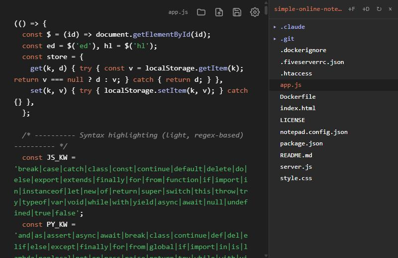
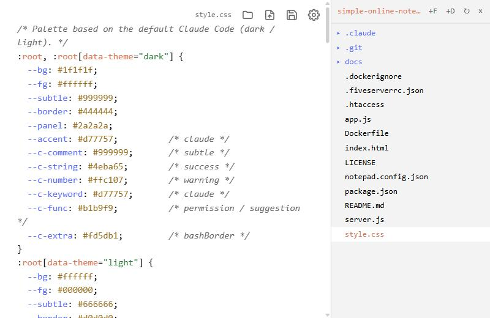
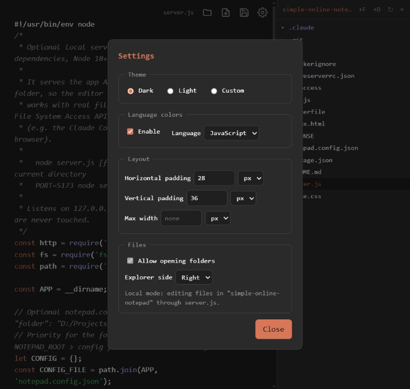

<div align="center">

# 📝 Simple Online Notepad

**A fast, distraction-free online notepad and plain-text / code editor that runs entirely in your browser.**
Claude Code–inspired dark & light themes · syntax colors for 20 languages · open, edit and save real files and folders · zero dependencies.

[](LICENSE)
[](https://github.com/oGabrielFreitas/simple-online-notepad/stargazers)
[](https://github.com/oGabrielFreitas/simple-online-notepad/commits/main)
[](https://github.com/oGabrielFreitas/simple-online-notepad/issues)
[](https://github.com/oGabrielFreitas/simple-online-notepad/pulls)


</div>

<p align="center">
  
</p>

<p align="center">
  
  &nbsp;
  
</p>

---

## ✨ Why Simple Online Notepad?

Most online notepads are cluttered, ad-filled or send your text to a server. This one is the opposite: a single static page, a few buttons in the corner, and your words stay on your device.

- **Just write.** No account, no sign-up, no tracking, no backend. Text is autosaved in your browser (`localStorage`).
- **Looks like Claude Code.** Default *dark* and *light* themes use the Claude Code terminal palette (the signature `#D77757` orange, plus its success, warning and suggestion colors).
- **Your colors, your rules.** Pick any background and text color, set horizontal/vertical padding in `px`, `%`, `vh` or `vw`, and cap the writing width.
- **Syntax colors for 20 languages.** Plain text (default), Markdown, JavaScript, TypeScript, Python, Java, C, C++, C#, Go, Rust, PHP, Ruby, Shell, SQL, JSON, YAML, HTML, XML and CSS.
- **Real files, real folders.** Open a file from your computer, edit it, and press <kbd>Ctrl</kbd>+<kbd>S</kbd> to save straight back to it. Optionally browse a whole folder in a side explorer (left or right), create files and folders, and switch projects.
- **Deploy anywhere.** Drop three static files on any shared host, or ship the included `Dockerfile` to Coolify, Docker, Nginx, Netlify, Vercel or GitHub Pages.

## 🖼️ Features at a glance

| Feature | Details |
| --- | --- |
| Autosave | Text is kept in `localStorage`; nothing leaves your browser |
| Themes | Dark, Light (Claude Code palette) and Custom (any background/text color) |
| Syntax colors | 20 languages, lightweight regex highlighter (no libraries) |
| Layout | Horizontal & vertical padding (`px`, `%`, `vh`, `vw`) and max width (`px`, `%`, `vw`, `ch`) |
| Open / Save | Open any text file, save in place with <kbd>Ctrl</kbd>+<kbd>S</kbd>, *Save as* with <kbd>Ctrl</kbd>+<kbd>Shift</kbd>+<kbd>S</kbd> |
| Folder explorer | Browse, open, create files/folders; explorer on the right (default) or left |
| Local server mode | Optional `server.js` that gives file access in browsers without the File System Access API |
| Footprint | 3 static files, 0 dependencies, no build step |

## 🚀 Quick start

### Option 1 — Just open it (static)

Serve the folder with any static server, or upload `index.html`, `style.css` and `app.js` to your hosting. That's the whole app.

```bash
npx serve .
```

### Option 2 — Local mode with real file access (`npm start`)

Runs a tiny, dependency-free Node.js server (Node 18+) that serves the app **and** reads/writes files in a folder. It works in every browser, including the built-in browser of **Claude Code** and the Claude desktop app.

```bash
npm start                           # edits the current folder → http://localhost:5173
npm start -- "D:/Projects/my-app"   # edit a specific folder
```

- The folder button opens a **folder chooser** so you can switch to any folder on your computer.
- Click a file in the explorer to edit it. <kbd>Ctrl</kbd>+<kbd>S</kbd> saves in place.
- In Claude Code, start it with `preview_start` using the `notepad` entry in [`.claude/launch.json`](.claude/launch.json).

Set a default folder and port with [`notepad.config.json`](notepad.config.json):

```json
{ "folder": "D:/Projects/my-app", "port": 5173 }
```

`folder` can be absolute or relative to `server.js`; leave it empty to use the current directory. Priority: command-line folder → `NOTEPAD_ROOT` → config file → current directory.

### Option 3 — Docker / Coolify

```bash
docker build -t simple-online-notepad . && docker run -p 8080:80 simple-online-notepad
```

**Coolify:** New Resource → Public/Private Repository → select this repo → Build Pack **Dockerfile** → Ports Exposes **80** → set your domain → Deploy.

### Option 4 — Shared hosting (cPanel, Hostinger, etc.)

Upload `index.html`, `style.css`, `app.js` and (optionally) `.htaccess`. No Node.js required. Use **HTTPS** so the browser enables direct file access.

## 🌐 Browser support

| Browser | Notepad, themes, autosave | Open / save in place / folders |
| --- | :---: | :---: |
| Chrome, Edge (HTTPS or `localhost`) | ✅ | ✅ |
| Brave | ✅ | ⚠️ enable `brave://flags/#file-system-access-api` |
| Firefox, Safari | ✅ | ⚠️ opens files, *Save* downloads a copy |
| Claude Code / Claude desktop browser pane | ✅ | ✅ with `npm start` (local mode) |

Direct file access uses the [File System Access API](https://developer.mozilla.org/docs/Web/API/File_System_API), which needs a secure context (HTTPS or `localhost`).

## 🔒 Privacy & security

- The static app has **no backend and no analytics**. Your text stays in your browser.
- Local mode listens on `127.0.0.1` only, rejects non-localhost `Host` headers (DNS-rebinding protection), requires a custom request header (blocks cross-site requests) and never reads or writes outside the selected folder, including through symlinks.

## 🗂️ Project structure

```text
index.html            App markup (+ critical layout CSS)
style.css             Themes (Claude Code palette) and UI
app.js                Editor, highlighter, files, explorer, settings
server.js             Optional local file server (Node 18+, no dependencies)
notepad.config.json   Optional default folder/port for the local server
package.json         `npm start`
Dockerfile            Nginx image for Coolify / Docker
.htaccess             Optional Apache tweaks for shared hosting
.fiveserverrc.json    Five Server config (static preview)
docs/                 Screenshots
```

## ❓ FAQ

**What is Simple Online Notepad?**
A free, open-source, browser-based notepad and lightweight code editor. It autosaves text locally, supports dark/light/custom themes and syntax colors, and can open and save real files and folders.

**Does it upload or store my text on a server?**
No. In the static version your text lives in your browser's `localStorage`. In local mode, files are only read and written on your own computer.

**Can I use it as an online Markdown editor or code editor?**
Yes. Pick Markdown, JavaScript, Python, SQL and 16 other languages for syntax colors, then save with any extension.

**Does it work offline?**
Yes, once loaded it needs no network. Run `npm start` or any static server locally.

**Can I edit files inside the Claude Code browser?**
Yes. That browser can't open the system file picker, so run `npm start`; the app then reads and writes files through the local server.

**Is it affiliated with Anthropic?**
No. The themes are inspired by the default Claude Code terminal colors; this is an independent project.

**How do I self-host it?**
Upload the three static files to any host, or deploy the Dockerfile to Coolify/Docker. See [Quick start](#-quick-start).

## 🙌 Credits

Created by **[Gabriel Freitas](https://github.com/oGabrielFreitas)**.

- 🎥 YouTube: **[DescolaDev](https://www.youtube.com/@DescolaDev)**: programming, tools and automation content.
- 🚀 **[Lance no Digital](https://lancenodigital.com.br/)**: digital marketing agency by Gabriel Freitas.

If this project helps you, give it a ⭐ and subscribe to the channel!

## 📄 License

Licensed under the [Apache License 2.0](LICENSE).

---

<sub>Keywords: online notepad, web notepad, browser text editor, online code editor, Markdown editor, plain text editor, Claude Code theme, dark mode notepad, File System Access API, self-hosted notepad, Coolify, Docker, Node.js, vanilla JavaScript.</sub>
